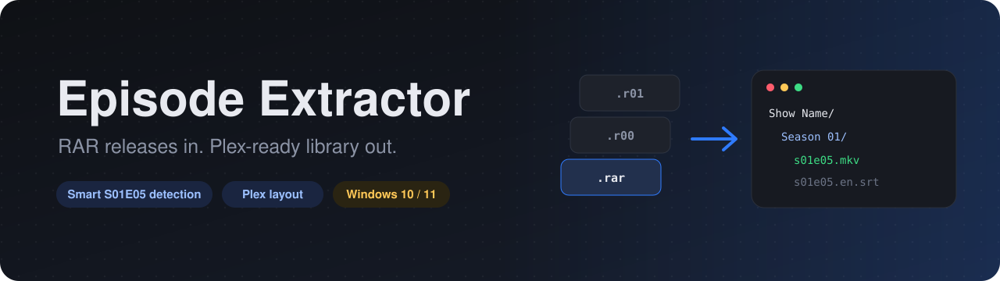

<p align="center">
  
</p>

<p align="center">
  <a href="../../releases/latest"></a>
  
  
  
  <a href="LICENSE"></a>
</p>

<p align="center">
  <b>Unpack multi-part RAR episode releases and file them straight into your Plex TV library.</b><br>
  Point it at a downloads folder, check what it found, hit Start. Done.
</p>

<p align="center">
  <a href="#quick-start">Quick start</a> &middot;
  <a href="#features">Features</a> &middot;
  <a href="#what-it-recognizes">What it recognizes</a> &middot;
  <a href="#build-it-yourself">Build it yourself</a> &middot;
  <a href="#faq">FAQ</a>
</p>

---

## Before and after

<table>
<tr>
<th>Your downloads folder</th>
<th>Your Plex library, after one click</th>
</tr>
<tr>
<td valign="top">

```text
Downloads\
  Show.Name.S01E05.1080p.WEB.x264-GRP\
    show.name.s01e05.rar
    show.name.s01e05.r00
    show.name.s01e05.r01
    show.name.s01e05.sfv
  Show.Name.S01E06.1080p.WEB.x264-GRP\
    show.name.s01e06.part01.rar
    show.name.s01e06.part02.rar
```

</td>
<td valign="top">

```text
TV Shows\
  Show Name\
    Season 01\
      Show Name - s01e05.mkv
      Show Name - s01e05.en.srt
      Show Name - s01e06.mkv
```

</td>
</tr>
</table>

## Quick start

1. Install [7-Zip](https://www.7-zip.org/) if you don't have it. The app finds it automatically.
2. Download **`Extractor.exe`** from the [latest release](../../releases/latest) and run it.
3. Drag your downloads folder onto the window (or hit **Browse**). It scans right away.
4. Switch on **Plex layout** and pick your **TV library** folder.
5. Check the **Lands in** column, untick anything you don't want, then hit **Start extracting**.

> **Tip:** turn on **Preview only** for a dry run. The log shows exactly where every file would go, and nothing is touched.

Prefer the script? Run it directly, no build needed:

```powershell
powershell -ExecutionPolicy Bypass -File .\Extractor-GUI.ps1
```

## Features

| | |
|---|---|
| **Finds every RAR set** | `name.rar` + `.r00, .r01...` and `name.part01.rar, .part02.rar...`, in every subfolder. Incomplete sets (no first volume) are skipped and counted. |
| **Smart episode detection** | Reads season and episode from release names, and strips junk like `1080p`, `x264`, `HEVC`, audio tags and years first, so `720p` is never read as season 7, episode 20. |
| **Plex layout** | Moves the video to `Show\Season NN\Show - sNNeMM.ext`, the naming Plex matches best. |
| **Subtitles come along** | Matching `.srt / .ass / .ssa / .sub / .idx / .vtt` files are renamed with the episode, keeping tags like `.en` or `.forced`. |
| **Season packs** | One archive holding a whole season? Each episode is sorted into its own season folder. |
| **Safe by default** | Source RARs are only deleted (if you turn that on) once the video is safely in place. Existing library files are never overwritten. Sample files are ignored. |
| **Zero setup** | Finds 7-Zip on its own (Program Files, registry, PATH, or a portable `7z.exe` next to the app). Remembers your folders and options. |
| **Clear when things go wrong** | Every release shows a live status. The log opens on its own if anything fails, and startup errors are written to `Extractor-error.log`. |

## What it recognizes

| Release name contains | Detected as | Lands in (Plex layout) |
|---|---|---|
| `Show.Name.S01E05.1080p` | `S01E05` | `Show Name\Season 01\Show Name - s01e05` |
| `Show.Name.1x05.720p` | `S01E05` | `Show Name\Season 01\Show Name - s01e05` |
| `Show.Name.Season.2.Episode.4` | `S02E04` | `Show Name\Season 02\Show Name - s02e04` |
| `Show.Name.S02E10E11` / `S02E10-E11` | `S02E10-E11` | `Show Name\Season 02\Show Name - s02e10-e11` |
| `Show.Name.Episode.12` | `E12` | `Show Name\Season 01\Show Name - s01e12` |
| `Daily.Show.2024.03.15` | `2024-03-15` | `Daily Show\Season 2024\Daily Show - 2024-03-15` |
| `Show.Name.S03.Extras` | `S03.Extras` | `Show Name\Season 00\...` |
| `Show.Name.102.HDTV` | `S01E02` | `Show Name\Season 01\Show Name - s01e02` |
| `Movie.Name.1080p.BluRay.x264` | not an episode | extracted next to its RARs, not moved into the library |

## Build it yourself

```powershell
powershell -ExecutionPolicy Bypass -File .\Build-Exe.ps1
```

This installs the [ps2exe](https://github.com/MScholtes/PS2EXE) module for your user the first time (needs internet), then compiles `Extractor.exe` next to the script, with no console window.

**Custom icon:** drop an `app.ico` next to the script before building and it becomes the exe and window icon. An `app.png` or `app.jpg` is used as the header image in the app.

## FAQ

<details>
<summary><b>Windows SmartScreen warns me about the exe</b></summary>

The exe isn't code-signed, so Windows doesn't recognize it yet. Click **More info**, then **Run anyway**. If you'd rather not, run `Extractor-GUI.ps1` directly or build the exe yourself from this source.
</details>

<details>
<summary><b>Plex matched the wrong show</b></summary>

Show folders use the cleaned-up title from the release name, without a year. For remakes and reboots, rename that show's folder to include the year (for example `Doctor Who (2005)`). New episodes keep landing there as long as the release names produce the same title.
</details>

<details>
<summary><b>A row says "No video"</b></summary>

The archive extracted fine but had no video over 20 MB in it (or only a sample). The extracted files are left in place and the source RARs are kept, so nothing is lost.
</details>

<details>
<summary><b>Where are my settings stored?</b></summary>

`%APPDATA%\EpisodeExtractor\config.json`. Delete it to reset everything.
</details>

<details>
<summary><b>The app won't open</b></summary>

Look for `Extractor-error.log` next to the app. It has the full error, so please include it if you open an issue.
</details>

## License

[MIT](LICENSE) &copy; RamenNuudls
